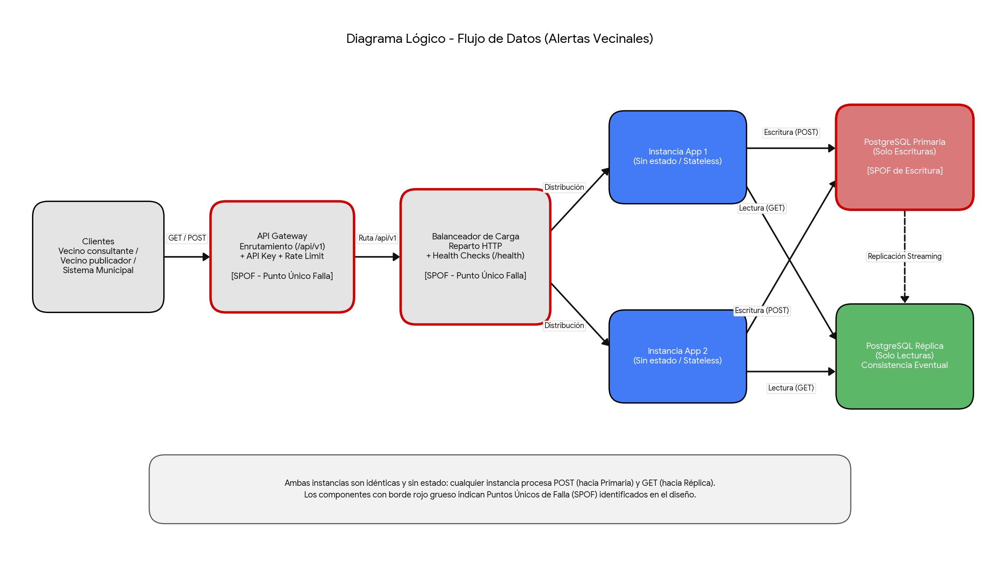
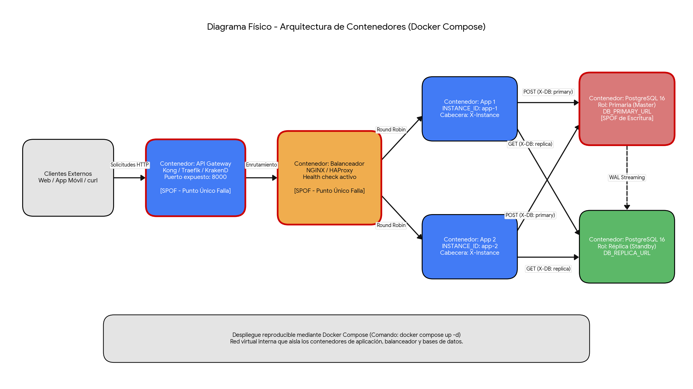

# Diseño de la solución: alertas comunitarias vecinales

## 1. Problemática

En una comunidad vecinal, los avisos importantes suelen circular por canales dispares como grupos de WhatsApp, mensajes privados, publicaciones en redes sociales o avisos verbales entre vecinos. Esto hace que la información se disperse, se pierda fácilmente y sea difícil validar si un aviso sigue vigente.

La solución propuesta consiste en una plataforma centralizada donde las personas puedan publicar y consultar avisos comunitarios desde un único lugar. El sistema está pensado para vecinos que necesitan estar informados sobre cortes de agua, seguridad, objetos perdidos, actividades comunitarias y otros avisos relevantes. La primera versión se limita a consultar y publicar avisos; no incluye mensajería, geolocalización, notificaciones automáticas ni moderación avanzada.

### Usuarios

- Vecino consultante: revisa los avisos y busca información actualizada.
- Vecino que publica: registra un aviso para que la comunidad lo conozca.

### Justificación del patrón de lectura/escritura

La naturaleza del problema es de alta lectura y baja escritura. Un aviso se publica una sola vez, pero puede ser consultado muchas veces por distintos vecinos a lo largo del día. Por ejemplo, un aviso de corte de agua puede ser leído por decenas de personas en pocas horas.

Por esa razón, la solución se diseña para una relación de lectura/escritura de al menos 10:1. Es decir, se espera que por cada publicación haya al menos 10 consultas. Esta proporción justifica una arquitectura con base de datos primaria para escrituras y réplica de lectura para consultas.

## 2. Requisitos funcionales

La solución debe cumplir estos ocho requisitos funcionales:

1. **RF-01:** El sistema debe listar los avisos comunitarios vigentes y recientes.
2. **RF-02:** El sistema debe permitir publicar un aviso con título, descripción, categoría y fecha.
3. **RF-03:** El sistema debe mostrar el detalle completo de un aviso seleccionado.
4. **RF-04:** El sistema debe permitir diferenciar los avisos por categoría.
5. **RF-05:** Toda respuesta HTTP debe incluir `X-Instance`, que identifica la instancia de aplicación que la procesó.
6. **RF-06:** Toda respuesta HTTP debe incluir `X-DB`, que identifica la base de datos utilizada.
7. **RF-07:** Las operaciones de escritura deben dirigirse exclusivamente a la base primaria y reportar `X-DB: primary`.
8. **RF-08:** Las operaciones de lectura deben dirigirse exclusivamente a la réplica y reportar `X-DB: replica`.

## 3. Requisitos no funcionales

### Latencia objetivo

- La consulta de avisos debe responder en menos de 500 ms en condiciones normales.
- La escritura debe responder en menos de 1 segundo, considerando la operación de persistencia en la base primaria.

### Disponibilidad

- La plataforma debe seguir funcionando aunque una instancia de la aplicación falle.
- El sistema debe tolerar la caída de una instancia sin que se interrumpa el servicio de consulta.

### RPO (Recovery Point Objective)

- El RPO máximo es de **5 minutos**: se acepta perder, como máximo, las escrituras de los últimos 5 minutos ante una falla catastrófica de la primaria que aún no se hayan replicado.

### RTO (Recovery Time Objective)

- El RTO máximo es de **30 minutos** para restaurar el flujo de publicación ante un incidente importante, incluyendo la recuperación de la primaria o la promoción de la réplica y la reanudación de la capa de aplicación.

### Otros requisitos no funcionales

- Escalabilidad horizontal para aumentar el número de instancias.
- Separación clara entre lectura y escritura.
- Facilidad de trazabilidad y diagnóstico.
- Simplicidad de uso para usuarios no técnicos.

## 4. Estimación de carga

### Supuestos

- La comunidad tiene 500 vecinos activos.
- En promedio, se publican 5 avisos por día.
- Cada aviso es consultado 10 veces como mínimo.
- En la hora punta, la actividad puede llegar a triplicarse.
- El contenido promedio de un aviso es 2 KB.
- El sistema conserva avisos recientes y relevantes durante 5 años.

### Lecturas y escrituras estimadas

#### Promedio diario

- Escrituras: 5 avisos/día
- Lecturas: 50 consultas/día
- Relación estimada: 10:1

#### En hora punta

- La actividad de referencia puede aumentar hasta tres veces respecto del promedio; las consultas se concentran alrededor de avisos de mayor interés.
- La proporción de diseño se mantiene en al menos 10 lecturas por cada escritura. No se asigna un valor de solicitudes por segundo sin una medición de tráfico que lo respalde.

### Almacenamiento estimado a 5 años

- Avisos en 5 años: 5 avisos/día × 365 días/año × 5 años = **9.125 avisos**.
- Tamaño promedio de un aviso (texto, título, descripción y metadatos): **2 KB**.
- Sobrecosto estimado de almacenamiento por registro para índices, metadatos y logs de transacciones: **50%**; por tanto, 2 KB × 1,5 = **3 KB por aviso**.
- Almacenamiento total estimado: 9.125 avisos × 3 KB = 27.375 KB; 27.375 KB / 1.024 = **26,7 MB** a 5 años.

La estimación considera registros e índices; no incluye archivos adjuntos ni copias de seguridad. El supuesto de 5 avisos diarios y 2 KB por aviso es la base del cálculo.

Esto confirma que el sistema es pequeño y viable para una infraestructura con una base de datos PostgreSQL y una réplica en Docker Compose.

## 5. Diagrama lógico

El diagrama lógico representa el flujo de información entre usuarios, la capa de aplicación y las bases de datos.

### Flujo principal

1. El vecino consultante realiza una petición GET para consultar avisos.
2. La petición entra por el API Gateway.
3. El Gateway enruta la solicitud al balanceador.
4. El balanceador distribuye la lectura entre una de las instancias de la aplicación.
5. La instancia lee desde la base de datos réplica.
6. La respuesta incluye X-Instance y X-DB con la identidad de la instancia y de la base que atendió la consulta.

### Flujo de escritura

1. El vecino que publica ingresa un aviso.
2. La petición entra por el API Gateway.
3. El Gateway la enruta al balanceador.
4. El balanceador usa una instancia disponible.
5. La instancia escribe a la base primaria.
6. La réplica se sincroniza con la primaria mediante streaming.
7. La respuesta confirma la operación y devuelve la trazabilidad de la instancia y base.

El diagrama lógico muestra las dos instancias procesando lecturas hacia la réplica y escrituras hacia la primaria. El API Gateway y el balanceador se identifican como SPOF.

Archivo editable: [DIAGRAMA_LOGICO.drawio](./diagramas/DIAGRAMA_LOGICO.drawio).

## 6. Diagrama físico

La arquitectura física propuesta es la siguiente:

- API Gateway: punto único de entrada para todas las peticiones. Es un Punto Único de Falla (SPOF) de la capa de entrada.
- Balanceador de carga: distribuye la carga entre las instancias de la aplicación. También es un Punto Único de Falla (SPOF) si no existe redundancia.
- Dos instancias idénticas de la aplicación:
  - sin estado
  - compartiendo la lógica y recursos de la base
- Base de datos primaria: recibe las operaciones de escritura.
- Réplica de lectura: responde a las consultas de lectura.
- Docker Compose: orquesta todo el entorno como un único despliegue reproducible.

La idea es separar de forma clara las responsabilidades para demostrar el flujo real de lectura y escritura en la arquitectura, identificando explícitamente los puntos de falla críticos del sistema.

Archivo editable: [DIAGRAMA_FISICO.drawio](./diagramas/DIAGRAMA_FISICO.drawio).

## 7. Justificación de cada componente

### API Gateway

**Qué problema resuelve:**
- Centraliza la entrada a la aplicación.
- Permite enrutar por ruta, por ejemplo /api/v1/avisos.
- Puede aplicar políticas como API key o limitación de peticiones por cliente.

**Alternativa:**
- Usar un balanceador avanzado como HAProxy para hacer ambas funciones, pero limitaría las capacidades de gestión de API (validación JWT, transformaciones de cuerpos, auditoría, y políticas por ruta).

**Qué pasaría sin él:**
- Las aplicaciones y clientes tendrían que acceder directamente a los servicios.
- Se perdería una capa de control, seguridad y agrupación de rutas.

**Costo que agrega:**
- Añade consumo de recursos, configuración y mantenimiento; puede aumentar la latencia si no está bien configurado.
- En este despliegue local con una opción de código abierto no implica una licencia comercial, aunque sí tiene costo operativo.

### Balanceador de carga

**Qué problema resuelve:**
- Distribuye las peticiones entre 2 o más instancias de la aplicación.
- Evita que una sola instancia se sature.
- Permite drenar tráfico si una instancia cae.

**Alternativa:**
- Usar DNS Round Robin, pero no tendría health checks ni retirada automática de instancias caídas, lo que afectaría directamente la disponibilidad.

**Qué pasaría sin él:**
- La carga quedaría concentrada en una sola instancia.
- Si esa instancia fallara, el sistema quedaría caído o con alto degradamiento.

**Costo que agrega:**
- Añade consumo de recursos y complejidad de despliegue; requiere configurar y mantener health checks y distribución de tráfico.
- En este despliegue local con una opción de código abierto no implica una licencia comercial, aunque sí tiene costo operativo.

### Aplicación

**Qué problema resuelve:**
- Implementa la lógica de negocio.
- Expone endpoints de lectura y escritura.
- Mantiene la solución sin estado.

**Alternativa:**
- Implementar la lógica directamente en un único servidor monolítico, pero esto es menos escalable y complica la evolución sin afectar la disponibilidad del sistema.

**Qué pasaría sin él:**
- No existiría la capa que procesa avisos y entrega la información a los clientes.

**Costo que agrega:**
- Requiere mantener varias instancias idénticas.
- Hay que asegurar consistencia y traza de peticiones.

### Base primaria

**Qué problema resuelve:**
- Recibe todas las escrituras.
- Garantiza consistencia y origen de verdad del sistema.

**Alternativa:**
- Usar una base de datos NoSQL como MongoDB, pero PostgreSQL nos da garantías ACID más apropiadas para la escritura crítica y la integridad del contenido publicado.

**Qué pasaría sin ella:**
- La aplicación no tendría un punto único de verdad para almacenar avisos.
- Habría riesgo de pérdida o incoherencia de datos.

**Costo que agrega:**
- Consume recursos de cómputo y almacenamiento, y requiere respaldos, monitoreo y mantenimiento para sostener su disponibilidad.
- PostgreSQL no implica una licencia comercial en este despliegue; el costo principal es operativo y de infraestructura.

### Réplica de lectura

**Qué problema resuelve:**
- Ataca la mayoría de las consultas sin saturar la primaria.
- Mejora la latencia y la escalabilidad del sistema.

**Alternativa:**
- Mantener todas las consultas sobre la primaria, pero eso concentraría carga y perjudicaría la latencia y la disponibilidad del servicio.

**Qué pasaría sin ella:**
- Todas las consultas deberían ir a la primaria.
- La respuesta sería más lenta y la carga de escritura se elevaría.

**Costo que agrega:**
- Requiere recursos adicionales de cómputo y almacenamiento, además de configuración y monitoreo de la replicación.
- Puede presentar retraso de consistencia; PostgreSQL no implica una licencia comercial en este despliegue, pero sí costo operativo y de infraestructura.

## 8. Riesgos del diseño y mitigación

### Riesgo 1: retraso de replicación

**Descripción:**
- La réplica puede quedarse ligeramente atrasada respecto a la primaria.

**Mitigación:**
- Definir explícitamente que la lectura de avisos debe considerarse eventual.
- Usar la primaria para confirmaciones críticas y la réplica para consultas no críticas.

### Riesgo 2: caída de una instancia de la aplicación

**Descripción:**
- Si una instancia falla, podría afectar la disponibilidad del servicio si el balanceador no detecta bien el problema.

**Mitigación:**
- Configurar health checks y retirar la instancia caída del pool de tráfico.
- Mantener al menos 2 instancias para tolerar una caída.

### Riesgo 3: Puntos Únicos de Falla (SPOF) en la capa de entrada

**Descripción:**
- El API Gateway y el Balanceador de Carga son actualmente Puntos Únicos de Falla (SPOF). Si cualquiera de ellos se cae, todo el sistema queda inaccesible.

**Mitigación:**
- Para un entorno de producción real (fuera del alcance de este proyecto local), se desplegarían múltiples instancias del Gateway y del Balanceador usando IPs flotantes (Keepalived) o servicios administrados en la nube.

## 9. Conclusión

Este diseño cumple con el problema planteado y con la justificación técnica requerida para una arquitectura con réplica de lectura, balanceador y API Gateway. La solución prioriza la consulta de avisos comunitarios, minimiza la carga de la base primaria y permite una trazabilidad clara de la infraestructura que responde cada petición.

La arquitectura es simple, escalable y apropiada para la fase inicial del proyecto, cumpliendo con la restricción de un alcance pequeño y una solución ejecutable con Docker Compose.
