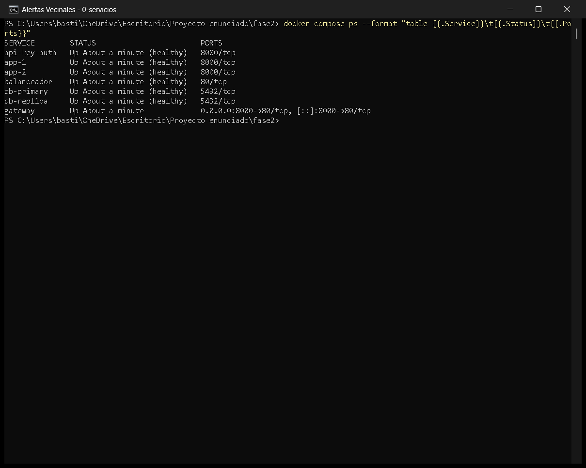
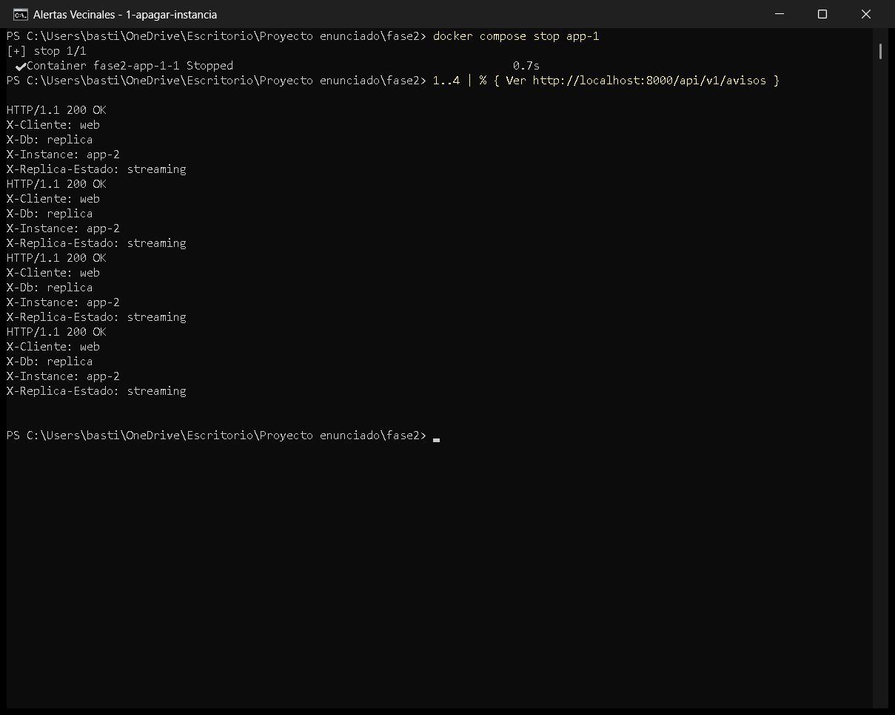
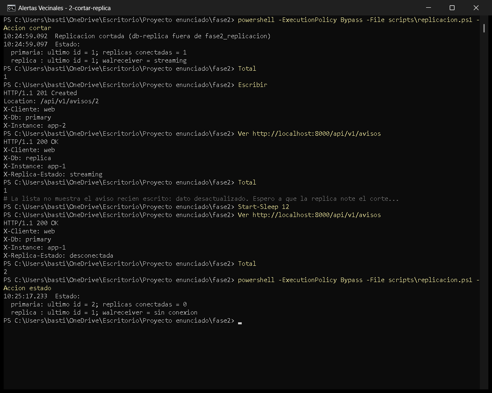
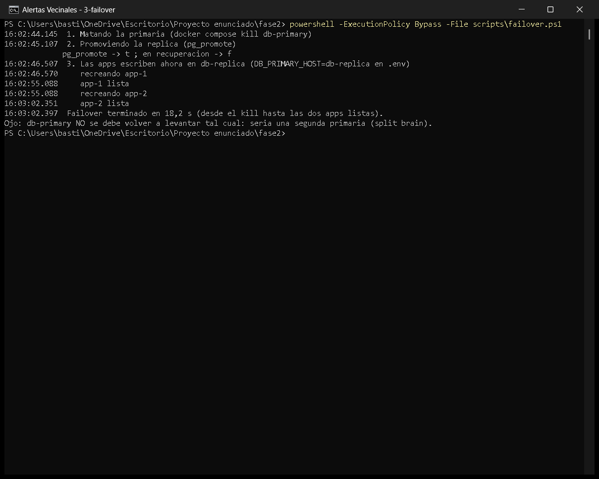
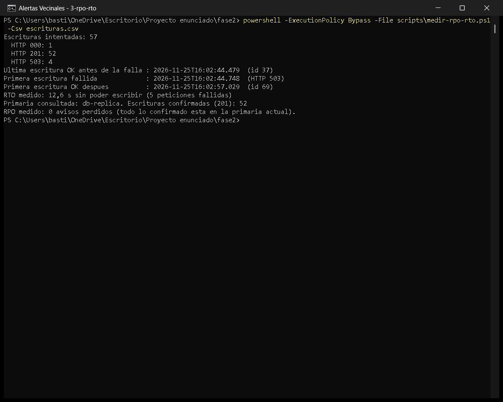

# Pruebas de falla · Fase 3

Todas las salidas de este documento son reales. Se obtuvieron en PowerShell (Windows 11, Docker Desktop) con el sistema completo de la Fase 3 levantado desde cero, después de programar la aplicación real (18 de noviembre) y antes de subirlas al repositorio (19 de noviembre, 09:03).

> **Sobre las fechas.** Las horas de las salidas y de los CSV dicen **17 de noviembre** porque el reloj del computador tenía mal la fecha durante las pruebas. Se dejaron tal cual para no alterar los datos medidos.

> Para no borrar los datos del despliegue principal, las mediciones se hicieron en un proyecto de Compose aparte (`$env:COMPOSE_PROJECT_NAME='alertas-f3'`). Por eso los contenedores aparecen como `alertas-f3-...` en vez de `fase2-...`. Los comandos y la configuración son exactamente los mismos.

Todos los scripts están en [`fase2/scripts/`](../../fase2/scripts/) y se ejecutan desde la carpeta `fase2`:

| Script | Para qué |
|---|---|
| `escrituras.ps1` | Escribe un aviso cada 200 ms por el gateway y guarda cada respuesta (hora, código HTTP, id) en un CSV |
| `replicacion.ps1 -Accion cortar\|restaurar\|estado` | Corta o restaura **solo** el enlace de streaming primaria → réplica |
| `failover.ps1` | Mata la primaria, promueve la réplica y redirige las escrituras de las apps |
| `medir-rpo-rto.ps1 -Csv archivo.csv` | Calcula RTO y RPO a partir del CSV de escrituras |
| `restaurar.ps1 -Confirmar` | Vuelve al estado inicial (**borra los datos**) |

Si PowerShell bloquea los scripts, se ejecutan con `powershell -ExecutionPolicy Bypass -File scripts\<script>.ps1`.

> **Capturas.** Al final de cada experimento hay una captura de pantalla de la consola. Las capturas son de una segunda corrida, el **25 de noviembre de 2026**, con el sistema principal (`fase2-...`) y la versión final del código. Por eso sus números pueden diferir un poco de las mediciones de la primera corrida que están en el texto.



## Resumen

| # | Experimento | Resultado medido | Objetivo (Fase 1) |
|---|---|---|---|
| 1 | Apagar `app-1` con lecturas continuas | **0 errores** en 161 lecturas; 3 lecturas tardaron ~2 s | Disponibilidad 99,5 % ✔ |
| 2 | Cortar la replicación | **11,6 s** de lecturas desactualizadas; después la app lee en la primaria | — |
| 3A | Matar la primaria con la replicación sana | **RTO 6,8 s · RPO 0 avisos** | RTO ≤ 30 min ✔ · RPO ≤ 5 min ✔ |
| 3B | Matar la primaria con la replicación cortada hace 14 s | **RTO 13,3 s · RPO 52 avisos (13,9 s)** | RPO ≤ 5 min ✔, pero con ids reutilizados ⚠ |
| + | Apagar una base completa (24 nov) | Antes: lecturas de 3–4 s. Después del arreglo: **0 errores**, lecturas de ~12 ms | Latencia < 500 ms ✔ |

---

## Experimento 1 · Apagar una instancia de la aplicación

**Qué hice.** Durante 30 s hice una lectura `GET /api/v1/avisos` cada 100 ms por el gateway. A los 5 s detuve `app-1` con `docker compose stop app-1` y 15 s después la volví a levantar con `docker compose start app-1`.

```text
20:14:55.411 STOP app-1
20:14:56.457 app-1 detenida
20:15:11.465 START app-1

Total: 161
HTTP 200: 161
app-1: 28
app-2: 133
Max ms: 2023
Lentas >200ms:
t            http   ms inst
20:14:56.197 200  2017 app-2
20:15:04.462 200  2023 app-2
20:15:06.795 200  2018 app-2
```

**Qué pasó.**

- **Ninguna lectura falló** (161 de 161 con `200`). Mientras `app-1` estuvo abajo todas las respuestas traen `X-Instance: app-2`.
- Tres lecturas tardaron ~2 s. Es el `proxy_connect_timeout 2s` de NGINX: intenta conectarse a `app-1`, espera 2 s, y como está en `proxy_next_upstream error timeout` reintenta en `app-2`. El cliente recibe `200`, solo que más lento.
- NGINX OSS hace comprobaciones **pasivas** (`max_fails=2 fail_timeout=10s`): no sabe de antemano que `app-1` cayó. Lo descubre con peticiones reales y la saca 10 s. Cuando vencen esos 10 s la vuelve a probar, y por eso hay una petición lenta cada ~10 s.
- `app-1` quedó lista 3,2 s después del `start` (log `Application startup complete` a las 20:15:14.7). NGINX la vuelve a usar cuando vence el `fail_timeout`, y después la alternancia `app-1`/`app-2` sigue normal.

**Cuánto duró.** Impacto para el usuario: 0 errores. La degradación fueron 3 peticiones de ~2 s en 15 s de caída.

**Qué aprendí.**

- Como las instancias no tienen estado, da igual cuál responde: perder una no pierde datos ni sesiones.
- Las comprobaciones pasivas tienen un costo: alguien "paga" el timeout para descubrir la caída. Con comprobaciones activas (HAProxy o NGINX Plus) la instancia sale antes de que la toque un cliente. Bajar `proxy_connect_timeout` (por ejemplo a 500 ms) también reduce ese costo.
- **Bug corregido en esta fase:** antes `proxy_next_upstream` incluía `http_500` y `http_503`. Cuando cae la base, *ambas* apps devuelven 503, NGINX las marcaba a las dos como caídas y respondía 502 también a las lecturas. Ahora solo se reintenta cuando falla la instancia (`error timeout http_502 http_504`), no cuando falla la base compartida.

**Captura (25 de noviembre).** Con `app-1` detenida, las cuatro lecturas responden `200` y todas las atiende `app-2`:



---

## Experimento 2 · Cortar la comunicación con la réplica

### Cómo se corta solo la replicación

La primaria y la réplica comparten una red Docker exclusiva, `replicacion`, y la réplica se conecta a la primaria con el alias `db-primary-repl`, que solo existe en esa red. `scripts\replicacion.ps1 -Accion cortar` ejecuta `docker network disconnect <proyecto>_replicacion <db-replica>`. Con eso la réplica **sigue accesible para las apps** (red `data`) pero deja de recibir WAL. Es el caso realista: la réplica responde, pero con datos viejos.

### Cómo lo maneja la aplicación

Antes de cada lectura la app consulta el estado de la réplica en la misma conexión (`pg_is_in_recovery()`, `pg_stat_wal_receiver`, `pg_is_wal_replay_paused()`) y decide:

| Estado de la réplica (`X-Replica-Estado`) | Dónde lee (`X-DB`) |
|---|---|
| `streaming`: conectada a la primaria | `replica` |
| `promovida`: ya es la primaria tras un failover | `replica` |
| `desconectada`: el walreceiver perdió a la primaria | `primary` (dato fresco) |
| `pausada`: recibe WAL pero no lo aplica | `primary` |
| `caida`: no responde | `primary` |
| Réplica `desconectada` **y** primaria caída | `replica` + `X-Datos-Desactualizados: posible` |

La última fila es una decisión de diseño: en un tablón de avisos vecinales es mejor mostrar avisos de hace unos minutos, advirtiéndolo, que devolver un 503.

### Qué hice y qué pasó

Corté la replicación, escribí el aviso 4 y leí la lista cada 500 ms:

```text
20:16:42.662 cortar
20:16:47.550 POST id=4
20:16:47.683 +  5,0s X-DB=replica  X-Replica-Estado=streaming     total=3
20:16:48.261 +  5,6s X-DB=replica  X-Replica-Estado=streaming     total=3
...
20:16:53.761 + 11,1s X-DB=replica  X-Replica-Estado=streaming     total=3
20:16:54.300 + 11,6s X-DB=primary  X-Replica-Estado=desconectada  total=4
20:16:54.854 + 12,2s X-DB=primary  X-Replica-Estado=desconectada  total=4
...
20:17:03.724 + 21,1s X-DB=primary  X-Replica-Estado=desconectada  total=4
Ventana de lecturas desactualizadas: 11,6 s
```

Comparación directa en las dos bases durante el corte (primera corrida, después de escribir los avisos 2 y 3):

```text
primaria total: 3
replica  total: 1
```

Diagnóstico de la app (`GET /api/v1/replicacion`) durante el corte: la primaria ya no tiene réplicas conectadas y la réplica se quedó en el id 3.

```json
{"instance_id":"app-2",
 "primary":{"ok":true,"ultimo_id":4,"replicas_conectadas":[]},
 "replica":{"ok":true,"estado":"desconectada","ultimo_id":3}}
```

**Lectura de lo recién escrito durante la ventana desactualizada.** Corté la replicación, escribí el aviso 5 y lo leí de inmediato, mientras la réplica todavía creía estar en `streaming`:

```text
POST id=5
--- lista (replica aun cree estar en streaming):
X-Db: replica
X-Replica-Estado: streaming
{"total":4, ... "items":[{"id":4, ...}]}          <- dato viejo: falta el 5
--- detalle del recien escrito:
HTTP/1.1 200 OK
X-Db: primary                                      <- la réplica no lo tenía; respondió la primaria
X-Replica-Estado: streaming
{"id":5,"titulo":"Recien escrito", ...}
```

**Restauración.** `scripts\replicacion.ps1 -Accion restaurar` volvió a conectar la red. La réplica quedó en `streaming` **5,7 s** después, se puso al día sola gracias al WAL retenido (`wal_keep_size=256MB`), y las lecturas volvieron a `X-DB: replica` con `total=3` (todo al día).

**Cuánto duró.** Ventana de lecturas desactualizadas en la lista: **11,6 s**. Reconexión: 5,7 s.

**Qué aprendí.**

- La réplica **no sabe al instante** que perdió a la primaria. Lo descubre cuando vence `wal_receiver_timeout`. Con el valor por defecto (60 s) la ventana habría sido de ~1 minuto; por eso lo bajé a `10s` (y `wal_sender_timeout=10s` en la primaria). La ventana medida, 11,6 s, es ese timeout más el tiempo de la prueba.
- Durante esa ventana la lista puede estar atrasada, pero el **detalle** de un aviso recién escrito nunca da un 404 falso, porque antes de responder 404 la app confirma en la primaria.
- Leer en la primaria cuando la réplica falla tiene costo: con la relación de diseño de 150 lecturas por escritura, la primaria pasa a atender unas 150 veces más consultas que solo escribiendo. A la escala de esta maqueta no importa; en producción habría al menos 2 réplicas.

**Captura (25 de noviembre).** Después de cortar la replicación se escribe el aviso 2: la lectura sale de la réplica, todavía en `streaming`, con `Total = 1` (dato desactualizado). A los 12 s la réplica ya sabe que está `desconectada` y la app lee en la primaria, con `Total = 2`. Al final, `estado` muestra que la primaria va en el id 2 y la réplica se quedó en el 1:



---

## Experimento 3 · Matar la primaria y promover la réplica

### Procedimiento

1. `scripts\escrituras.ps1 -Segundos 40` escribe un aviso cada ~200 ms por el gateway y registra cada respuesta en un CSV.
2. A los ~12 s, `scripts\failover.ps1`:
   1. `docker compose kill db-primary` (la mata de golpe, sin apagado ordenado),
   2. `SELECT pg_promote(true, 30)` en `db-replica`,
   3. escribe `DB_PRIMARY_HOST=db-replica` en `.env` y recrea `app-1` y luego `app-2`, de a una para que siempre quede una atendiendo lecturas.
3. `scripts\medir-rpo-rto.ps1` calcula:
   - **RTO** = tiempo entre la última escritura confirmada antes de la falla y la primera confirmada después.
   - **RPO** = avisos que recibieron `201` y **no** están en la nueva primaria. Se compara id **y** título; más abajo se explica por qué no basta el id.

Los CSV completos están en [`datos/failover-a.csv`](datos/failover-a.csv) y [`datos/failover-b.csv`](datos/failover-b.csv).

### 3A · Replicación sana (el caso normal)

```text
20:22:20.171  1. Matando la primaria (docker compose kill db-primary)
20:22:20.990  2. Promoviendo la replica (pg_promote)
             pg_promote -> t ; en recuperacion -> f
20:22:21.901  3. Las apps escriben ahora en db-replica (DB_PRIMARY_HOST=db-replica en .env)
20:22:21.931     recreando app-1
20:22:27.050     app-1 lista
20:22:27.052     recreando app-2
20:22:33.616     app-2 lista
20:22:33.661  Failover terminado en 13,5 s (desde el kill hasta las dos apps listas).
==========
Escrituras intentadas: 108
  HTTP 000: 3
  HTTP 201: 105

Ultima escritura OK antes de la falla : 2026-11-17T20:22:20.430  (id 33)
Primera escritura fallida             : 2026-11-17T20:22:20.709  (HTTP 000)
Primera escritura OK despues          : 2026-11-17T20:22:27.180  (id 34)
RTO medido: 6,8 s sin poder escribir (2 peticiones fallidas)

Primaria consultada: db-replica. Escrituras confirmadas (201): 105
RPO medido: 0 avisos perdidos (todo lo confirmado esta en la primaria actual).
```

- **RTO = 6,8 s.** Las escrituras volvieron cuando `app-1` quedó apuntando a la réplica promovida. La promoción en sí tomó menos de 1 s; el resto es recrear la app.
- **RPO = 0.** La réplica iba al día (el lag en reposo es de milisegundos), así que todo lo confirmado estaba en ella.
- Las fallas son `000`: el cliente (`curl -m 3`) se rindió a los 3 s porque la app esperaba la conexión a una primaria que ya no existía. Hubo un tercer `000` aislado a las 20:22:27.475: cayó en `app-2`, que todavía no se recreaba y seguía apuntando a la primaria muerta.

### 3B · Replicación cortada antes de la caída (el peor caso)

Para ver un RPO distinto de cero, corté la replicación (como en el experimento 2), seguí escribiendo 14 s y recién entonces maté la primaria.

```text
20:24:10.467  Replicacion cortada (db-replica fuera de alertas-f3_replicacion)
20:24:24.237  1. Matando la primaria (docker compose kill db-primary)
20:24:24.955  2. Promoviendo la replica (pg_promote)
             pg_promote -> t ; en recuperacion -> f
20:24:30.678  3. Las apps escriben ahora en db-replica (DB_PRIMARY_HOST=db-replica en .env)
20:24:37.779     app-1 lista
20:24:44.227     app-2 lista
20:24:44.269  Failover terminado en 20,0 s (desde el kill hasta las dos apps listas).
==========
Escrituras intentadas: 87
  HTTP 000: 5
  HTTP 201: 82

Ultima escritura OK antes de la falla : 2026-11-17T20:24:24.380  (id 74)
Primera escritura fallida             : 2026-11-17T20:24:24.657  (HTTP 000)
Primera escritura OK despues          : 2026-11-17T20:24:37.643  (id 34)
RTO medido: 13,3 s sin poder escribir (4 peticiones fallidas)

Primaria consultada: db-replica. Escrituras confirmadas (201): 82
RPO medido: 52 avisos confirmados se PERDIERON (2026-11-17T20:24:10.451 a 2026-11-17T20:24:24.380, ventana de 13,9 s)
  ids perdidos: 23, 24, 25, ..., 73, 74
  OJO: 8 de esos ids ahora pertenecen a OTRO aviso en la nueva primaria: 34, 35, 36, 37, 38, 39, 40, 41
```

- **RPO = 52 avisos, 13,9 s de datos.** Se perdió todo lo escrito entre el corte y la caída. Al cliente le respondimos `201` y el dato ya no existe. Es la consecuencia directa de que la replicación sea **asíncrona**.
- **RTO = 13,3 s.** Es mayor que en 3A porque `pg_promote` tardó 5,7 s: la réplica estaba en medio de sus reintentos de conexión a la primaria.
- **Hallazgo importante: ids reutilizados.** La nueva primaria siguió numerando desde el **34**, aunque la vieja había llegado al 74. Los avisos 34 a 41 de antes de la falla (perdidos) y los 34 a 41 nuevos son avisos **distintos con el mismo id**. Un vecino que guardó el enlace `/api/v1/avisos/34` ahora ve otro aviso. Por eso `medir-rpo-rto.ps1` compara id + título: comparando solo el id, el RPO salía 8 avisos menor de lo real.

### Qué aprendí del experimento 3

1. **El RPO depende del lag al momento de la caída, no del diseño en abstracto.** Con la réplica al día perdimos 0; con 14 s de atraso perdimos 14 s. El objetivo de la Fase 1 (RPO ≤ 5 min) se cumple solo si se **vigila el lag** y se alerta mucho antes de llegar a 5 min. `GET /api/v1/replicacion` muestra `bytes_pendientes` y `replicas_conectadas` para eso.
2. **El RTO real lo domina la parte manual.** Promover tarda menos de 1 s; lo lento es reconfigurar las apps. En la maqueta fueron 7–13 s porque lo hace un script; con una persona siguiendo un runbook serían minutos. El objetivo de 30 min se cumple con holgura, pero solo si alguien está de guardia.
3. **Los ids generados por la base no sobreviven a un failover con pérdida.** PostgreSQL registra la secuencia en el WAL en bloques de 32 valores, así que tras promover un nodo atrasado la numeración puede volver atrás. Opciones: usar UUID como identificador público, o después de promover avanzar la secuencia con margen (`SELECT setval(...)` por sobre el máximo que vio cualquier cliente).
4. **Riesgo de split brain.** Si alguien vuelve a levantar `db-primary` tal cual, habría dos primarias aceptando escrituras. `failover.ps1` lo advierte. La forma correcta es reconstruir la vieja primaria como réplica nueva (`pg_basebackup` o `pg_rewind`).

### Qué haría distinto

- **Failover automático** con Patroni (más etcd), o `target_session_attrs=read-write` en la URL de la app con varios hosts, para que las apps encuentren solas la nueva primaria sin recrearse.
- **Replicación síncrona** (`synchronous_commit=on` con `synchronous_standby_names`) solo si el negocio exigiera RPO = 0. Cuesta latencia en cada POST y, si la réplica cae, la primaria deja de aceptar escrituras. Para avisos vecinales el RPO de 5 min no lo justifica.
- **Comprobaciones activas** en el balanceador y un `proxy_connect_timeout` más corto.

### Capturas (25 de noviembre)

Una corrida nueva del caso 3A, con la réplica al día: `escrituras.ps1` escribió durante 30 s y a los 10 s se lanzó `failover.ps1`. El failover completo, desde el kill hasta las dos apps listas, tardó 18,2 s:



La medición de esa corrida da **RTO 12,6 s** y **RPO 0 avisos**: de 57 escrituras, 52 confirmadas y 5 fallidas durante el corte. El CSV está en [`datos/failover-2026-11-25.csv`](datos/failover-2026-11-25.csv). El RTO es mayor que los 6,8 s de la primera corrida porque esta vez `app-1` tardó 8,5 s en recrearse (5,1 s en la primera). Los dos quedan muy por debajo del objetivo de 30 minutos.



## Experimento adicional · Apagar una base de datos completa (24 de noviembre)

**Qué hice.** Con el sistema real levantado, apagué el contenedor de una base (`docker compose stop db-replica` y, en otra corrida, `docker compose stop db-primary`) mientras hacía un `GET` y un `POST` cada 500 ms por el gateway. Es distinto del experimento 2: ahí la réplica seguía prendida, aquí desaparece.

**Qué pasó la primera vez (con el código anterior).** Las lecturas no fallaban, pero **cada una tardaba de 3 a 4 s**. Con el cliente esperando 3 s, todas las lecturas se cortaron (`000`). Medí la causa dentro de la app:

```text
db-replica apagada -> resolver el nombre tarda 4,03 s ("Name or service not known")
noexiste-xyz       -> 4,0 s
```

Con un contenedor apagado, el DNS interno de Docker no conoce el nombre y se lo pregunta a un servidor externo, que tarda ~4 s en responder que no existe. La app volvía a preguntar en **cada** lectura.

**Qué cambié.**

1. `dns_opt: timeout:1, attempts:1` en las apps: se rinden al segundo.
2. Un cortacircuito en `leer()`: si una base falla, durante 10 s (`DB_PAUSA_S`) las lecturas van directo a la otra sin volver a intentarla.

**Resultado después del cambio** (GET y POST cada 500 ms):

| Base apagada | Lecturas | Escrituras | Cabeceras |
|---|---|---|---|
| Réplica | 16 de 16 con `200` | 16 de 16 con `201` | `X-DB: primary`, `X-Replica-Estado: caida` |
| Primaria (sin failover) | 5 de 5 con `200` | `503` (esperado) | `X-DB: replica`, `X-Replica-Estado: desconectada` |

Con la réplica apagada, la primera lectura de cada instancia tarda ~2 s y las siguientes **~12 ms**. Al volver a prender la réplica, las lecturas regresan solas a `X-DB: replica`. Durante todas las pruebas la RAM del equipo no pasó del 75 %.

**Qué aprendí.**

- Un mismo componente caído se puede ver de dos formas: la réplica desconectada responde rápido con datos viejos; la réplica apagada no responde y hace esperar. Hay que probar las dos.
- Probar en vivo encontró algo que el diseño no consideraba: el tiempo de resolver un nombre. Un timeout bien puesto vale tanto como la redundancia.
- Al agregar el cortacircuito introduje un error (las lecturas daban `500` con la primaria apagada) y lo encontré repitiendo la prueba. Por eso cada cambio se vuelve a probar con la misma falla.

## Cómo repetir las pruebas

```powershell
cd fase2
docker compose up -d --build

# Experimento 1
docker compose stop app-1      # mientras se hacen lecturas
docker compose start app-1

# Experimento 2
powershell -ExecutionPolicy Bypass -File scripts\replicacion.ps1 -Accion cortar
#   ...escribir y leer, mirar X-DB y X-Replica-Estado...
powershell -ExecutionPolicy Bypass -File scripts\replicacion.ps1 -Accion restaurar

# Experimento 3 (en dos consolas)
powershell -ExecutionPolicy Bypass -File scripts\escrituras.ps1 -Segundos 40   # consola 1
powershell -ExecutionPolicy Bypass -File scripts\failover.ps1                   # consola 2, a los ~10 s
powershell -ExecutionPolicy Bypass -File scripts\medir-rpo-rto.ps1 -Csv escrituras.csv

# Experimento adicional: apagar una base completa
docker compose stop db-replica   # o db-primary; leer y escribir mirando X-DB y X-Replica-Estado
docker compose start db-replica

# Volver al estado inicial (BORRA los datos)
powershell -ExecutionPolicy Bypass -File scripts\restaurar.ps1 -Confirmar
```
